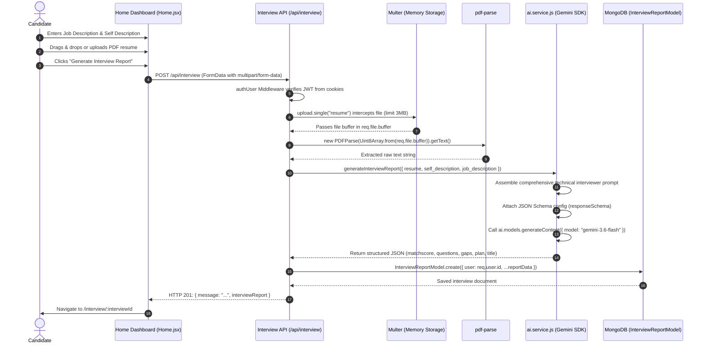
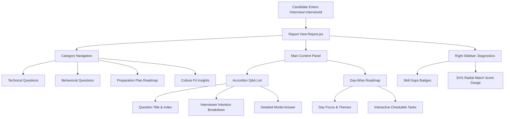

# 🚀 AI-Powered Resume Analyzer & Interview Preparation Assistant

A full-stack, AI-driven career acceleration platform designed to evaluate candidate resumes against target job descriptions, identify critical skill gaps, calculate compatibility match scores, and generate tailored technical/behavioral interview preparation roadmaps using Google's Gemini Generative AI.

---

## 📑 Table of Contents

- [Overview](#-overview)
- [Key Features](#-key-features)
- [System Architecture](#-system-architecture)
- [End-to-End Project Workflow](#-end-to-end-project-workflow)
  - [1. User Authentication Flow](#1-user-authentication-flow)
  - [2. Resume Parsing & AI Evaluation Pipeline](#2-resume-parsing--ai-evaluation-pipeline)
  - [3. Interactive Preparation & Report Dashboard](#3-interactive-preparation--report-dashboard)
- [Tech Stack](#-tech-stack)
- [Directory & File Breakdown](#-directory--file-breakdown)
  - [Backend Structure](#backend-structure)
  - [Frontend Structure](#frontend-structure)
- [Database Schema Design](#-database-schema-design)
  - [User Model](#1-user-model-users)
  - [Blacklist Token Model](#2-blacklist-token-model-blacklisttokens)
  - [Interview Report Model](#3-interview-report-model-interviewreports)
- [API Reference](#-api-reference)
  - [Authentication Endpoints (`/api/auth`)](#authentication-endpoints-apiauth)
  - [Interview Endpoints (`/api/interview`)](#interview-endpoints-apiinterview)
- [Gemini AI Service & Structured Outputs](#-gemini-ai-service--structured-outputs)
- [Setup & Installation Guide](#-setup--installation-guide)
  - [Prerequisites](#prerequisites)
  - [Backend Configuration](#backend-configuration)
  - [Frontend Configuration](#frontend-configuration)
  - [Running the Application](#running-the-application)
- [Design System & UI Experience](#-design-system--ui-experience)
- [Codebase Observations & Recommended Next Steps](#-codebase-observations--recommended-next-steps)

---

## 🌟 Overview

Job hunting and technical interview preparation are often fragmented and stressful. Candidates struggle to understand how well their resume aligns with specific job descriptions, what questions they will encounter, and how to systematically prepare within days.

This platform bridges that gap by combining:
1. **Automated Resume Parsing**: In-memory extraction of candidate experience and qualifications directly from PDF files.
2. **Context-Aware AI Analysis**: Leveraging Google's `gemini-3.6-flash` model to analyze job requirements, candidate resumes, and personal self-descriptions.
3. **Structured Interview Intelligence**: Generating categorized technical questions, behavioral situational questions, intention analysis, expected answers, skill gap assessments, and an actionable 5–7 day preparation roadmap.
4. **Sleek, Modern Frontend**: A responsive, glassmorphism-styled dashboard built with React 19, Vite, and SCSS.

---

## ✨ Key Features

- **🔐 Secure Authentication & Session Management**:
  - User registration and login powered by `bcryptjs` (salt rounds: 10) and JSON Web Tokens (JWT).
  - Credentials transmitted securely via HTTP cookies (`withCredentials: true`).
  - Dedicated MongoDB token blacklist system for instant, stateless session revocation on logout.
  - Route-level client-side authentication guard (`Protected.jsx`) with automatic redirection.

- **📄 Resume PDF Extraction**:
  - Seamless drag-and-drop or file-picker upload for PDF resumes.
  - Streamed into memory via `multer` (no temporary disk clutter or filesystem leak risks, 3 MB limit).
  - Processed into raw text directly via `pdf-parse`.

- **🤖 AI-Powered Interview Generation (Google Gemini)**:
  - Enforced schema validation using `@google/genai` and JSON schema specifications.
  - **Match Score Calculation**: Real-time compatibility rating (0 to 100).
  - **Categorized Question Bank**:
    - At least 5 in-depth technical questions tailored to the candidate's stack and job requirements.
    - At least 5 behavioral questions formatted for situational interview techniques (e.g., STAR method).
    - Interviewer intention breakdowns and comprehensive model responses.
  - **Skill Gap Diagnosis**: Identifies missing or under-represented qualifications with severity indicators (`low`, `medium`, `high`).
  - **Day-Wise Preparation Plan**: A step-by-step roadmap (5–7 days) with clear focus areas and actionable daily checklist items.

- **🎨 Modern Glassmorphism UI & Interactive Visualizations**:
  - Mint & teal glassmorphism design system with responsive layouts.
  - Interactive SVG radial gauge displaying real-time compatibility scores.
  - Accordion-style collapsible Q&A cards.
  - Interactive, checkable daily preparation checklists.

---

## 🏗 System Architecture

The application adopts a decoupled client-server architecture:

```
┌─────────────────────────────────────────────────────────────┐
│                       React 19 Client                       │
│    Vite 8 • React Router 7 • Context API • SCSS Glassmorphism│
└──────────────┬──────────────────────────────▲───────────────┘
               │ HTTP Requests (JSON/Multipart)│ HTTP Cookies (JWT)
               │ withCredentials: true         │ JSON Responses
               ▼                               │
┌─────────────────────────────────────────────────────────────┐
│                    Express 5.x API Server                   │
│         CORS • Cookie Parser • Auth Middleware • Multer     │
└──────┬──────────────────────┬───────────────────────────────┘
       │                      │
       ▼                      ▼
┌──────────────┐       ┌──────────────────────────────────────┐
│  MongoDB     │       │   Google Gemini Generative AI API    │
│  (Mongoose)  │       │         (gemini-3.6-flash)           │
│  - Users     │       │  - Structured Schema Enforcement     │
│  - Blacklist │       │  - Evaluation & Roadmaps             │
│  - Reports   │       └──────────────────────────────────────┘
└──────────────┘
```

---

## 🔄 End-to-End Project Workflow

### 1. User Authentication Flow

```mermaid
sequenceDiagram
    autonumber
    actor User
    participant Frontend as Frontend (React / useAuth)
    participant AuthRouter as Express (/api/auth)
    participant AuthMiddleware as auth.middleware.js
    participant DB as MongoDB (Users & Blacklist)

    User->>Frontend: Enters username, email, password
    Frontend->>AuthRouter: POST /api/auth/register or /login
    AuthRouter->>DB: Check if email/username exists
    AuthRouter->>AuthRouter: Hash password with bcrypt / verify password
    AuthRouter->>AuthRouter: Generate JWT signed with JWT_SECRET (1d expiration)
    AuthRouter-->>Frontend: Set-Cookie: token=<jwt>; HttpOnly & JSON response
    Frontend->>Frontend: Update AuthContext user state & redirect to "/"
    
    Note over Frontend,AuthRouter: On protected route visits (e.g., page reload or Protected.jsx)
    Frontend->>AuthRouter: GET /api/auth/get-me (Cookie sent automatically)
    AuthRouter->>AuthMiddleware: Verify cookie presence & blacklist check
    AuthMiddleware->>DB: Query token in blacklistTokens collection
    AuthMiddleware->>AuthRouter: Decode JWT (req.user = decoded)
    AuthRouter->>DB: Fetch user by req.user.id
    AuthRouter-->>Frontend: Return { user: { id, username, email } }

    Note over Frontend,AuthRouter: On Logout
    User->>Frontend: Click Logout
    Frontend->>AuthRouter: GET /api/auth/logout
    AuthRouter->>DB: Store current token in blacklistTokens collection
    AuthRouter-->>Frontend: Clear-Cookie: token & { message: "User logged out successfully" }
```

---

### 2. Resume Parsing & AI Evaluation Pipeline



---

### 3. Interactive Preparation & Report Dashboard



---

## 💻 Tech Stack

### Frontend
| Technology | Version | Purpose |
| :--- | :--- | :--- |
| **React** | `^19.2.8` | Component-based user interface |
| **Vite** | `^8.2.0` | Ultra-fast development server and module bundler |
| **React Router DOM** | `^7.18.2` | Declarative routing & route-level authorization guards |
| **Axios** | `^1.19.0` | HTTP client with cookie/credential handling |
| **Sass / SCSS** | `^1.102.0` | Modular styling, glassmorphism design, variables, and mixins |
| **Tailwind CSS** | `^4.3.3` | Utility styling classes (`@tailwindcss/vite`) |
| **Lucide React** | `^1.31.0` | Consistent, lightweight vector icon set |
| **Oxlint** | `^1.75.0` | Fast Rust-based linter |

### Backend
| Technology | Version | Purpose |
| :--- | :--- | :--- |
| **Node.js** | `>=18.x` | JavaScript runtime environment |
| **Express.js** | `^5.2.1` | RESTful API web application framework |
| **MongoDB & Mongoose** | `^9.9.1` | NoSQL document database and Object Data Modeling (ODM) |
| **@google/genai** | `^2.16.0` | Official Google Gemini SDK (`gemini-3.6-flash`) |
| **jsonwebtoken (JWT)**| `^9.0.3` | Cryptographically signed authentication tokens |
| **bcryptjs** | `^3.0.3` | Secure password hashing algorithm |
| **multer** | `^2.2.0` | In-memory multipart/form-data upload handling |
| **pdf-parse** | `^2.4.5` | In-memory PDF binary parsing and text extraction |
| **cookie-parser** | `^1.4.7` | HTTP request cookie parser |
| **cors** | `^2.8.6` | Cross-Origin Resource Sharing middleware |
| **dotenv** | `^17.4.2` | Environment variable management |
| **zod / zod-to-json-schema** | `^4.4.3` / `^3.25.2`| Schema definition and validation utilities |

---

## 📁 Directory & File Breakdown

```
Resume-Builder-01/
├── Backend/
│   ├── src/
│   │   ├── config/
│   │   │   └── database.js              # Mongoose MongoDB connection establishment
│   │   ├── controllers/
│   │   │   ├── auth.controller.js       # Register, Login, Logout, and Get-Me logic
│   │   │   └── interview.controller.js  # PDF parsing, AI trigger, report CRUD
│   │   ├── middlewares/
│   │   │   ├── auth.middleware.js       # JWT cookie verification & blacklist check
│   │   │   └── file.middleware.js       # Multer memory storage (3MB limit)
│   │   ├── models/
│   │   │   ├── blacklist.model.js       # Blacklisted JWT store for session invalidation
│   │   │   ├── interviewReport.model.js # Schema for generated interview reports
│   │   │   └── user.model.js            # User credentials & profile schema
│   │   ├── routes/
│   │   │   ├── auth.routes.js           # Express router for /api/auth/*
│   │   │   └── interview.routes.js      # Express router for /api/interview/*
│   │   ├── services/
│   │   │   └── ai.service.js            # Gemini API integration & JSON Schema definition
│   │   ├── app.js                       # Express app configuration & middleware pipeline
│   │   └── temp.js                      # Test data containing sample resume & job descriptions
│   ├── .env                             # Backend environment secrets (excluded from git)
│   ├── .gitignore                       # Files and folders ignored by git
│   ├── package.json                     # Backend dependencies and run scripts
│   └── server.js                        # HTTP entrypoint listening on port 3000
│
├── Frontend/
│   ├── public/
│   │   ├── favicon.svg                  # Application favicon
│   │   └── icons.svg                    # Vector graphic assets
│   ├── src/
│   │   ├── features/
│   │   │   ├── auth/
│   │   │   │   ├── components/
│   │   │   │   │   └── Protected.jsx    # Route wrapper checking user auth status
│   │   │   │   ├── hooks/
│   │   │   │   │   └── useAuth.js       # Context consumer hook with login/reg/logout actions
│   │   │   │   ├── pages/
│   │   │   │   │   ├── Login.jsx        # Login page UI and event handling
│   │   │   │   │   └── Register.jsx     # Registration page UI and event handling
│   │   │   │   ├── services/
│   │   │   │   │   └── auth.api.js      # Axios API calls to /api/auth
│   │   │   │   ├── auth.context.jsx     # React Context provider holding user & loading state
│   │   │   │   └── auth.form.scss       # SCSS styles for authentication forms
│   │   │   └── interview/
│   │   │       ├── pages/
│   │   │       │   ├── Home.jsx         # Main dashboard with drag-drop upload & inputs
│   │   │       │   └── Report.jsx       # Interactive report viewer with Q&A, roadmap & score
│   │   │       ├── services/
│   │   │       │   └── report.api.js    # Axios calls for generating and retrieving reports
│   │   │       └── styles/
│   │   │           ├── home.scss        # Dashboard layout, drag-drop dropzone, and textarea styling
│   │   │           └── report.scss      # Glassmorphism panels, accordion cards, and radial gauge
│   │   ├── styles/
│   │   │   └── button.scss              # Reusable button styles and micro-animations
│   │   ├── App.jsx                      # Root React component providing AuthProvider & Router
│   │   ├── app.routes.jsx               # React Router configuration
│   │   ├── main.jsx                     # Vite entrypoint with React StrictMode
│   │   └── style.scss                   # Global resets, typography, and root viewport styling
│   ├── .oxlintrc.json                   # Oxlint configuration
│   ├── index.html                       # Single-page application HTML template
│   ├── package.json                     # Frontend dependencies and run scripts
│   └── vite.config.js                   # Vite configuration with React and Tailwind plugins
│
└── README.md                            # Comprehensive project documentation
```

### Backend Structure

- **`server.js`**: Initializes environment variables via `dotenv`, calls `connectDB()`, imports Express `app`, and binds to port `3000`.
- **`src/app.js`**: Sets up global middleware: `cookie-parser`, `express.json()`, and `cors` allowing origin `http://localhost:5173` with credentials. Mounts `/api/auth` and `/api/interview`.
- **`src/config/database.js`**: Connects to MongoDB via Mongoose using the connection string stored in `process.env.MONGO_URI`.
- **`src/services/ai.service.js`**: Initializes the Google GenAI SDK with `process.env.GOOGLE_GENAI_API_KEY`. Defines the strict JSON output schema using `Type.OBJECT`, `Type.ARRAY`, `Type.STRING`, and `Type.NUMBER`. Prompts `gemini-3.6-flash` and returns a parsed JSON report.
- **`src/middlewares/auth.middleware.js`**: Reads the `token` cookie from incoming requests. Validates that the token has not been recorded in `blacklistTokens`. Verifies the JWT signature with `process.env.JWT_SECRET` and attaches decoded payload (`req.user`) to the request object.
- **`src/middlewares/file.middleware.js`**: Uses `multer.memoryStorage()` with a file size limit of 3MB to buffer the uploaded resume in memory.
- **`src/controllers/auth.controller.js`**:
  - `registerUser`: Validates input, verifies uniqueness, hashes passwords with `bcrypt.hash(password, 10)`, signs a 1-day JWT, sets an HTTP cookie, and returns user details.
  - `loginUser`: Compares email and password using `bcrypt.compare`, signs a 1-day JWT, sets the cookie, and returns user profile.
  - `logoutUser`: Inserts the token into the blacklist collection and clears the cookie.
  - `getMeController`: Retrieves the currently logged-in user profile from `req.user.id`.
- **`src/controllers/interview.controller.js`**:
  - `generateInterviewReportController`: Parses `req.file.buffer` using `pdf-parse`, invokes `generateInterviewReport()`, merges with user inputs, and saves a new `InterviewReport` document.
  - `getInterviewReportBy_Id`: Retrieves a report by its ID belonging to the authenticated user.
  - `getAll_InterviewReports`: Lists all historical reports belonging to the authenticated user.

### Frontend Structure

- **`src/App.jsx`**: Wraps the application in `AuthProvider` so that authentication state is accessible globally across all routes.
- **`src/app.routes.jsx`**: Defines client routes:
  - `/login`: Public login page.
  - `/register`: Public registration page.
  - `/`: Protected home dashboard (`Home.jsx`).
  - `/interview/:interviewId`: Interview report view (`Report.jsx`).
- **`src/features/auth/hooks/useAuth.js`**: Custom hook encapsulating authentication state (`user`, `loading`) and dispatchers (`handleRegister`, `handleLogin`, `handleLogout`). Automatically triggers `getMe()` on initial mount to restore active sessions.
- **`src/features/auth/components/Protected.jsx`**: Protects child components from unauthenticated access by displaying a loading indicator while session state loads, or redirecting unauthenticated users to `/login`.
- **`src/features/interview/pages/Home.jsx`**:
  - Allows pasting of target job descriptions with a one-click clipboard copy utility.
  - Provides a drag-and-drop dropzone or manual file selector for `.pdf` resumes.
  - Collects self-descriptions to provide additional context to the AI.
- **`src/features/interview/pages/Report.jsx`**:
  - Category navigation bar for switching between Technical Questions, Behavioral Questions, Preparation Plan, and Culture Fit.
  - Interactive accordion question cards displaying the question text, the interviewer's hidden assessment intention, and the ideal answer.
  - Day-by-day preparation roadmap with checkable tasks.
  - Visual Skill Gaps cloud.
  - Animated SVG circular gauge illustrating the candidate-to-job match score.

---

## 🗄 Database Schema Design

### 1. User Model (`users`)
Located in `Backend/src/models/user.model.js`:

| Field | Type | Attributes | Description |
| :--- | :--- | :--- | :--- |
| `username` | String | Required, Unique, Trimmed | Unique candidate username |
| `email` | String | Required, Unique, Trimmed | Unique account email address |
| `password` | String | Required | Bcrypt-hashed password |
| `createdAt` / `updatedAt` | Date | Managed by Mongoose | Timestamps |

---

### 2. Blacklist Token Model (`blacklistTokens`)
Located in `Backend/src/models/blacklist.model.js`:

| Field | Type | Attributes | Description |
| :--- | :--- | :--- | :--- |
| `token` | String | Required | Invalidated JWT string |
| `createdAt` | Date | Timestamps enabled | Timestamp when token was revoked |

> **Architecture Tip**: This collection allows invalidating JWTs before their natural expiration (1 day), giving the application the security of token revocation without losing the simplicity of stateless JWTs.

---

### 3. Interview Report Model (`InterviewReport`)
Located in `Backend/src/models/interviewReport.model.js`:

```javascript
{
  user: { type: ObjectId, ref: 'users' },
  title: { type: String, required: true },
  jobDescription: { type: String, required: true },
  resume: { type: String },              // Extracted raw text from uploaded PDF
  selfDescription: { type: String },      // Candidate personal description
  matchscore: { type: Number, min: 0, max: 100 },
  technicalQuestions: [
    {
      question: { type: String, required: true },
      intention: { type: String, required: true },
      answer: { type: String, required: true }
    }
  ],
  behavioralQuestions: [
    {
      question: { type: String, required: true },
      intention: { type: String, required: true },
      answer: { type: String, required: true }
    }
  ],
  skillGaps: [
    {
      skill: { type: String, required: true },
      severity: { type: String, enum: ['low', 'medium', 'high'], required: true }
    }
  ],
  preparationPlan: [
    {
      day: { type: Number, required: true },
      focus: { type: String, required: true },
      tasks: [{ type: String, required: true }]
    }
  ],
  timestamps: true
}
```

---

## 📡 API Reference

Base URL: `http://localhost:3000`

### Authentication Endpoints (`/api/auth`)

#### 1. Register a User
- **Route**: `POST /api/auth/register`
- **Access**: Public
- **Request Body** (`application/json`):
  ```json
  {
    "username": "john_doe",
    "email": "john@example.com",
    "password": "SecurePassword123!"
  }
  ```
- **Responses**:
  - `201 Created`:
    ```json
    {
      "message": "User registered successfully",
      "user": {
        "id": "6724fa...",
        "username": "john_doe",
        "email": "john@example.com"
      }
    }
    ```
    *Sets `Set-Cookie: token=<jwt>; Path=/; HttpOnly`.*
  - `400 Bad Request`: Missing fields or email/username already registered.

#### 2. User Login
- **Route**: `POST /api/auth/login`
- **Access**: Public
- **Request Body** (`application/json`):
  ```json
  {
    "email": "john@example.com",
    "password": "SecurePassword123!"
  }
  ```
- **Responses**:
  - `200 OK`:
    ```json
    {
      "message": "User logged in successfully",
      "user": {
        "id": "6724fa...",
        "username": "john_doe",
        "email": "john@example.com"
      }
    }
    ```
    *Sets `Set-Cookie: token=<jwt>; Path=/; HttpOnly`.*
  - `400 Bad Request`: Invalid email or password.

#### 3. User Logout
- **Route**: `GET /api/auth/logout`
- **Access**: Public (reads cookie)
- **Responses**:
  - `200 OK`:
    ```json
    {
      "message": "User logged out successfully"
    }
    ```
    *Clears `token` cookie and inserts token into blacklist collection.*

#### 4. Fetch Current User Profile
- **Route**: `GET /api/auth/get-me`
- **Access**: Private (Requires valid `token` cookie)
- **Responses**:
  - `200 OK`:
    ```json
    {
      "message": "User fetched successfully",
      "user": {
        "id": "6724fa...",
        "username": "john_doe",
        "email": "john@example.com"
      }
    }
    ```
  - `401 Unauthorized`: Token missing, invalidated, or expired.

---

### Interview Endpoints (`/api/interview`)

#### 1. Generate Interview Report
- **Route**: `POST /api/interview/`
- **Access**: Private (Requires valid `token` cookie)
- **Content-Type**: `multipart/form-data`
- **Payload**:
  - `resume`: PDF File Binary (Max 3 MB)
  - `jobDescription`: String (Required)
  - `selfDescription`: String (Optional)
- **Responses**:
  - `201 Created`:
    ```json
    {
      "message": "Interview report generated successfully",
      "interviewReport": {
        "_id": "67250...",
        "user": "6724fa...",
        "title": "Senior Full Stack Engineer",
        "matchscore": 88,
        "technicalQuestions": [
          {
            "question": "How do you handle race conditions in Node.js microservices?",
            "intention": "Evaluates understanding of asynchronous I/O and distributed concurrency.",
            "answer": "Use distributed locks such as Redis Redlock, transactional queues, or idempotent operations..."
          }
        ],
        "behavioralQuestions": [
          {
            "question": "Tell me about a time you had to push back on a feature deadline.",
            "intention": "Gauges communication, risk mitigation, and stakeholder management skills.",
            "answer": "I used data-driven estimates, proposed an MVP scope, and negotiated a phased release..."
          }
        ],
        "skillGaps": [
          { "skill": "Kubernetes", "severity": "medium" },
          { "skill": "GraphQL", "severity": "low" }
        ],
        "preparationPlan": [
          {
            "day": 1,
            "focus": "System Architecture Refresh",
            "tasks": ["Review caching tiers with Redis", "Study CAP theorem scenarios"]
          }
        ],
        "createdAt": "2026-11-01T22:30:00.000Z"
      }
    }
    ```
  - `401 Unauthorized`: Unauthenticated request.
  - `500 Internal Server Error`: PDF parsing or AI generation failure.

#### 2. Get Specific Interview Report
- **Route**: `GET /api/interview/report/:interviewId`
- **Access**: Private (Requires valid `token` cookie)
- **Parameters**: `interviewId` (MongoDB ObjectId)
- **Responses**:
  - `200 OK`: Report document matching the ID and authenticated user.
  - `404 Not Found`: Report does not exist or belongs to another user.

#### 3. List All User Reports
- **Route**: `GET /api/interview/reports`
- **Access**: Private (Requires valid `token` cookie)
- **Responses**:
  - `200 OK`: Array of interview report summaries sorted by `createdAt: -1`.

---

## 🧠 Gemini AI Service & Structured Outputs

The backend integrates `@google/genai` to harness Google's `gemini-3.6-flash` model.

### Key Implementation Details:
1. **Schema Enforcement**:
   Rather than relying on free-form markdown or regex parsing of LLM outputs, the service enforces a rigorous JSON schema via `responseSchema` and `responseMimeType: "application/json"`.
2. **Guaranteed Structure**:
   The output is guaranteed to return:
   - `matchscore` (Numeric, 0 to 100)
   - `title` (String)
   - `technicalQuestions` (Array of objects with `question`, `intention`, `answer`)
   - `behavioralQuestions` (Array of objects with `question`, `intention`, `answer`)
   - `skillGaps` (Array of objects with `skill`, `severity: low|medium|high`)
   - `preparationPlan` (Array of objects with `day`, `focus`, and `tasks: string[]`)
3. **Prompt Engineering**:
   The system prompt sets the model role to an **Expert Technical Interviewer** and provides the extracted resume, candidate self-description, and job requirements as inputs.

---

## 🛠 Setup & Installation Guide

### Prerequisites

Make sure you have installed:
- [Node.js](https://nodejs.org/) (Version 18.x, 20.x, or higher)
- [MongoDB](https://www.mongodb.com/) (Local instance running on `mongodb://localhost:27017` or a MongoDB Atlas cloud URI)
- [Google Gemini API Key](https://aistudio.google.com/)

---

### Backend Configuration

1. Navigate to the backend directory:
   ```bash
   cd Backend
   ```

2. Install dependencies:
   ```bash
   npm install
   ```

3. Create an environment configuration file:
   Create a `.env` file in the `Backend/` folder with the following variables:
   ```env
   # Server Port
   PORT=3000

   # Database Connection
   MONGO_URI=mongodb://127.0.0.1:27017/resume-builder
   # Or MongoDB Atlas:
   # MONGO_URI=mongodb+srv://<username>:<password>@cluster.mongodb.net/resume-builder?retryWrites=true&w=majority

   # JWT Secret Key
   JWT_SECRET=your_super_secret_jwt_key_here_min_32_chars

   # Google Gemini API Key
   GOOGLE_GENAI_API_KEY=AIzaSy...your_gemini_api_key
   ```

4. Start the backend development server:
   ```bash
   npm run dev
   ```
   *The backend will run on `http://localhost:3000` and connect to MongoDB.*

---

### Frontend Configuration

1. Open a new terminal and navigate to the frontend directory:
   ```bash
   cd Frontend
   ```

2. Install dependencies:
   ```bash
   npm install
   ```

3. Start the Vite development server:
   ```bash
   npm run dev
   ```
   *The frontend will run on `http://localhost:5173`.*

---

### Running the Application

1. Open your browser and visit:
   ```
   http://localhost:5173
   ```
2. Click **Register** to create a new candidate account.
3. Upon registration, you are redirected to the Dashboard (`/`).
4. Paste a Job Description, write your Self-Description, upload a PDF resume, and generate your custom interview report.

---

## 🎨 Design System & UI Experience

The frontend is styled using SCSS with a custom glassmorphism aesthetic:

- **Color Palette**:
  - Background Mint: `#e9f7f2`
  - Background Soft White: `#f6faf9`
  - Floating Blur Blobs: `#b7ebd9` (Teal), `#c9e9f2` (Blue)
  - Dark Primary Text: `#23384a`
  - Placeholder & Secondary Text: `#8a9cab`
  - Accent Teal: `#2f7d76`
  - Accent Navy: `#1d3a56`
  - Accent Mint Highlight: `#5fc9ab`
  - Primary Action Pink / Red: `#e1034d`
- **Glassmorphism Panels**:
  - `rgba(255, 255, 255, 0.55)` background with subtle blur and translucent borders (`rgba(255, 255, 255, 0.7)`).
- **Custom SVG Radial Gauge**:
  - A dynamic SVG circle track with gradient stroke (`#1d3a56` to `#5fc9ab`), rotated `-90deg` to render score percentages cleanly without third-party heavy charting libraries.
- **Micro-Interactions**:
  - Smooth active button scaling (`transform: scale(0.9)`).
  - Hover states on categories, question accordion items, and checkable task buttons.

---

## 💡 Codebase Observations & Recommended Next Steps

While reviewing the codebase, here are a few targeted enhancements to make the platform even better:

1. **Wire Home Submit to API**:
   - In [`Frontend/src/features/interview/pages/Home.jsx`](Frontend/src/features/interview/pages/Home.jsx), the *"Generate Interview Report"* button is ready to be linked to `generateInterviewReport({ jobDescription, selfDescription, resumeFile })` from [`report.api.js`](Frontend/src/features/interview/services/report.api.js). On response, use `useNavigate()` to route the user to `/interview/${data.interviewReport._id}`.

2. **Connect Report Page to Live Backend Data**:
   - [`Frontend/src/features/interview/pages/Report.jsx`](Frontend/src/features/interview/pages/Report.jsx) currently displays mock data as a template. You can read `const { interviewId } = useParams()` and fetch live data using `getInterviewReportById(interviewId)`.

3. **Backend Controller Response Payload**:
   - In [`Backend/src/controllers/interview.controller.js`](Backend/src/controllers/interview.controller.js):
     - In `getInterviewReportBy_Id`: add `interviewReport: interview_Report` to `res.status(200).json(...)`.
     - In `getAll_InterviewReports`: add `interviewReports` to `res.status(200).json(...)`.

4. **MongoDB Indexing for Blacklist Tokens**:
   - Add a TTL (Time To Live) index to `blacklistTokens.createdAt` (e.g. `expires: '1d'`) in [`blacklist.model.js`](Backend/src/models/blacklist.model.js) so that expired tokens automatically purge themselves from the database.

---

## 📄 License

This project is licensed under the ISC License.

---

<p align="center">
  Built with ❤️ using React 19, Express 5, MongoDB, and Google Gemini AI.
</p>

